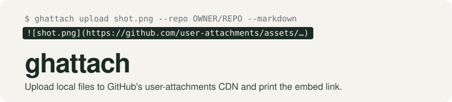
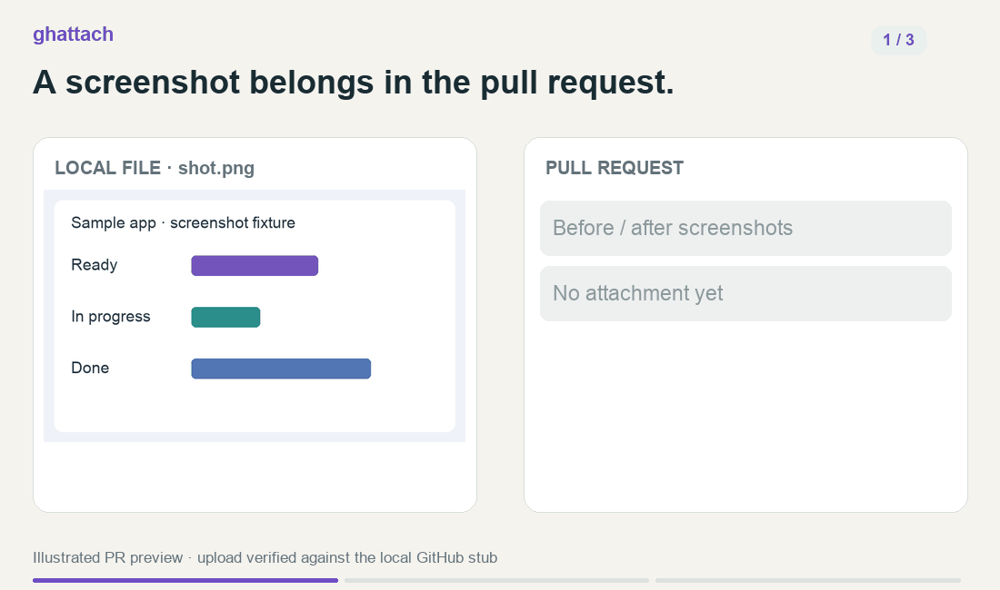
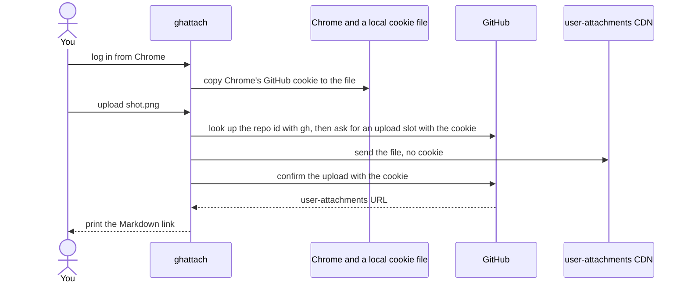

<picture>
  <source media="(prefers-color-scheme: dark)" srcset=".github/assets/banner-dark.svg">
  
</picture>

[](https://github.com/tetriz-ai/ghattach/actions/workflows/ci.yml)
[](https://pkg.go.dev/github.com/tetriz-ai/ghattach/cmd/ghattach)
[](LICENSE)
[](go.mod)

A screenshot or screen recording in a pull request usually means dragging the file into GitHub
in a browser, which a script or CI job cannot do, so the image gets committed or left out.
ghattach does that upload from a terminal and prints the link to paste, so nothing is committed.

This project is not affiliated with or endorsed by GitHub. It uses an undocumented endpoint
that GitHub can change or withdraw. Use is subject to [GitHub’s Terms of Service](https://docs.github.com/en/site-policy/github-terms/github-terms-of-service)
and [Acceptable Use Policies](https://docs.github.com/en/site-policy/acceptable-use-policies/github-acceptable-use-policies).
Attachments are not a general-purpose hosting service; automated bulk uploads may be restricted.



A local screenshot becomes a PR attachment; no image committed to git. [Demo details](.github/assets/demo/README.md).

## How it works

<details>
<summary>Implementation flow</summary>



ghattach keeps a copy of your GitHub browser session in a file on your machine. It asks GitHub for an
upload slot with that session, the same way the browser does when you drag a file in, and
prints the link GitHub returns. GitHub has no public API for this upload.


</details>

## Quick start

You need Go 1.26.10 or later, write access to the repository, and the
[GitHub CLI](https://cli.github.com) signed in, which ghattach uses to look up the repository id.

1. Install ghattach. `go install` puts it in `$(go env GOPATH)/bin`, which must be on your `PATH`.

   ```sh
   go install github.com/tetriz-ai/ghattach/cmd/ghattach@latest
   ```

2. Log in from Chrome on macOS, signed in to github.com. Choose "Allow" for this request when macOS asks
   for "Chrome Safe Storage". Repeat the approval when prompted. "Always Allow" gives
   `/usr/bin/security` standing access to the key that decrypts Chrome cookies across sites,
   allowing other local processes to use that access.

   The stored session can act as your whole GitHub account, so log in only on a machine you
   trust. On Linux or with another browser,
   [paste the cookie value](docs/install.md#log-in-with-the-cookie-value) instead.

   ```console
   $ ghattach login --from-chrome
   Session stored at /Users/you/.config/ghattach/cookies.json
   Verify with: ghattach upload <file> --repo OWNER/REPO
   ```

3. Upload an image and paste the printed line into a pull request or issue.

   ```console
   $ ghattach upload shot.png --repo OWNER/REPO --markdown
   
   ```

To see these steps work without a GitHub account, run `examples/embed-one-screenshot/run.sh`
from a clone. It runs them against a local stub of GitHub. Release archives and other routes are
in [docs/install.md](docs/install.md), and what to do when the session expires is in
[docs/usage.md](docs/usage.md).

## What's in the box

| Use | When you want to |
|---|---|
| [`ghattach upload`](docs/reference.md#ghattach-upload-file) | Get a link or Markdown embed for files to paste into a pull request, issue or comment |
| [`ghattach login`](docs/reference.md#ghattach-login) | Store your GitHub session, read from Chrome on macOS or pasted in |
| [`ghattach logout`](docs/reference.md#ghattach-logout) | Delete the stored session from a machine you are done with |
| [`ghattach completion`](docs/reference.md#ghattach-completion) | Load shell completion for bash, fish, PowerShell or zsh |

What it does not do:

- **No token login.** GitHub's upload endpoint rejects personal access and app tokens.
- **No delete, list or download.** ghattach only uploads.
- **No GitHub Enterprise Server.** Uploads go to github.com only.

## Common tasks

### Embed a video and a log next to a screenshot

`--markdown` prints an image embed, a bare URL for a video so GitHub shows its player, and a
link for any other file. [examples/video-and-files](examples/video-and-files/) runs this against the local stub.

```console
$ ghattach upload shot.png demo.mp4 build.log --repo OWNER/REPO --markdown

https://github.com/user-attachments/assets/<uuid>
[build.log](https://github.com/user-attachments/assets/<uuid>)
```

### Upload without the GitHub CLI

Look up the repository id once wherever `gh` works, then pass it with `--repo-id` on a machine
without `gh`, such as a CI runner. [examples/ci-comment](examples/ci-comment/) is a whole CI upload step.

```console
$ gh api repos/OWNER/REPO --jq .id
123456789
$ ghattach upload shot.png --repo OWNER/REPO --repo-id 123456789
https://github.com/user-attachments/assets/<uuid>
```

### Log in from a script or CI job

Pipe the value of GitHub's `user_session` cookie, such as a stored secret, into `login --cookie -`.
The prompt prints with no newline, so the output continues on its line. This is a full-account
session, not a repository-scoped token: possession can bypass a fresh password and two-factor
challenge. For CI, use a dedicated machine account with access only to a throwaway public test
repository. Keep the secret in a protected environment with required reviewers; never expose it
to pull-request code. See [CI setup](docs/usage.md#use-ghattach-in-a-ci-job).

```console
$ printf '%s\n' "$GITHUB_SESSION" | ghattach login --cookie -
Paste the user_session VALUE, then Enter: Session stored at /home/you/.config/ghattach/cookies.json
Verify with: ghattach upload <file> --repo OWNER/REPO
```

### Remove the stored session

`logout` deletes the local copy only. Revoke the session on GitHub if it may have leaked.

```console
$ ghattach logout
Removed /home/you/.config/ghattach/cookies.json
Also revoke the browser session if it is no longer wanted: https://github.com/settings/sessions
```

## Limitations

- **The stored session is your whole GitHub account.** Log in only on machines you trust.
- **Uploads to a public repository are public, and cannot be deleted.** Check each file before you upload it.
- **On macOS, an expired session may switch accounts.** Pin one by logging in with `--from-chrome --chrome-profile`.
- **A GitHub refusal stops the run.** Earlier files stay uploaded, so keep their links.
- **GitHub can change the upload endpoint at any time.** Do not let a failed upload fail a build.

The full list, with what to do about each one, is in [docs/limitations.md](docs/limitations.md).

## More

- [docs/reference.md](docs/reference.md): every flag, output rule, exit status and file location.
- [docs/install.md](docs/install.md): release archives, checksums and the pasted-cookie login.
- [docs/usage.md](docs/usage.md): expired sessions, CI jobs, profiles and GitHub's size limits.
- [examples/](examples/): complete scripts that run against a local stub, with no GitHub account.
- [CONTRIBUTING.md](CONTRIBUTING.md), [SECURITY.md](SECURITY.md) and the [MIT License](LICENSE).
- Parts of the upload client are adapted from [gh-image](https://github.com/drogers0/gh-image), as [NOTICE](NOTICE) records.

Releases follow [Semantic Versioning](https://semver.org) and list their changes in
[CHANGELOG.md](CHANGELOG.md). Before v1.0.0 a breaking change ships in a new minor version.
What counts as breaking is in [docs/reference.md](docs/reference.md#versioning-and-compatibility).

Copyright 2026 Workloom Solutions Private Limited. [CONTRIBUTORS.md](CONTRIBUTORS.md) lists the project's team.
